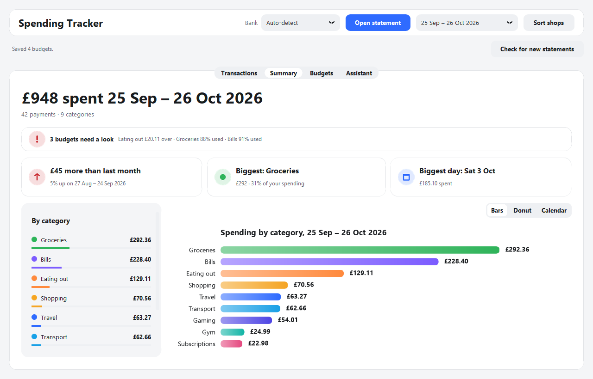

# Spending Tracker

A small Windows desktop app that reads your bank statements, sorts each payment into a category
with an AI model running on your own PC, and shows where your money goes, with charts, budgets
and an optional AI assistant.

It's a personal hobby project. I built it because I enjoy coding and playing with AI, and I wanted
a spending tracker that never sends my money data anywhere.



*The screenshot uses only the made-up statements in the `samples` folder.*

## What it does

1. You put your bank statements (PDF or CSV) in the `statements` folder.
2. The app reads every payment from them.
3. A local AI model (Llama 3.1 through Ollama) sorts each shop into a category such as Groceries,
   Bills or Eating out. It remembers each shop, so it only has to ask once, and you can change any
   category by hand.
4. The app does all the maths itself and shows totals, charts, budgets and simple insights for
   each pay month.

## Features

- **Reads several banks**: Chase UK PDF statements, Revolut CSV exports, and any other bank's CSV
  (you show it which columns are the date, description and amount once, and it remembers).
- **Local AI sorting** with Ollama. Shops it can't sort are listed so you can retry or sort them yourself.
- **Charts**: spending by category (bars or donut), spending by month, and a calendar heat map of
  each day's spending.
- **Pay-month budgets**: months run from payday to payday rather than 1st to 31st. Set a budget per
  category (or let the app suggest one from your past spending). Bars turn amber at 80% and red
  when you go over, and the Summary tab shows a warning card.
- **Statement auto-load**: anything in the `statements` folder is loaded when the app opens, and the
  "Check for new statements" button picks up new files.
- **Payday reminder** a couple of days before payday.
- **Optional AI assistant** (off by default): ask questions about your spending in plain English,
  and get a short monthly rundown in the few days before payday. The app works out every number
  and the AI only puts them into words.

## Privacy

- **Everything runs on your PC.** The AI model runs locally through Ollama. There are no online AI
  services, no accounts and no bank logins.
- **No data leaves your computer.** The app doesn't connect to the internet at all.
- **Real statements are never committed.** The `statements` and `data` folders (your statements,
  saved categories, budgets, settings and rundowns) are listed in `.gitignore`, so Git never
  uploads them.
- The tests and the screenshot use only the made-up files in `samples`.

## Requirements

- Windows 10 or 11
- [Python](https://www.python.org/downloads/) 3.11 or newer (started with the `py` command)
- [Ollama](https://ollama.com/download) with the `llama3.1:8b` model (about 5 GB to download)
- The Python packages in `requirements.txt`

## Setup

1. **Get the code.** Click the green **Code** button on this page, then **Download ZIP**, and unzip
   it. Or, if you use Git:
   ```bash
   git clone https://github.com/joeoverr/spending-tracker.git
   ```
2. **Open a terminal in the folder.** In File Explorer, open the `spending-tracker` folder, click the
   address bar, type `powershell` and press Enter.
3. **Install the Python packages:**
   ```bash
   py -m pip install -r requirements.txt
   ```
4. **Install Ollama** from [ollama.com](https://ollama.com/download), then download the model:
   ```bash
   ollama pull llama3.1:8b
   ```
5. **Add your statements.** Make a folder called `statements` inside `spending-tracker` and put your
   PDF or CSV statements in it. (To try the app first, copy the files from `samples` in there instead.)

## Running it

Start Ollama first (from the Start menu), then run:

```bash
py spending_app.py
```

The app loads your statements and starts sorting the shops. If Ollama isn't running, it says so;
start Ollama, wait a few seconds and click **Try again**.

## Running the tests

The tests use only the made-up sample data and don't need Ollama:

```bash
py -m unittest
```

## Project structure

```
spending_app.py      the window: tabs, buttons, tables and charts
app_logic.py         loading statements, budgets and settings (no window code)
banks/               one reader per bank: chase_uk.py, revolut.py, general_csv.py
categorise.py        sorting shops into categories with the local AI
summary.py           totals, budgets and the insight cards
payday.py            pay months and the payday rule
assistant.py         the optional AI assistant and monthly rundowns
charts.py            the matplotlib charts
theme.py, icons.py   colours, fonts, sizes and icons
storage.py           where things are saved (the data folder)
samples/             made-up statements for testing and the screenshot
make_samples.py      remakes the sample statements
check_statement.py   checks a statement is read correctly, printing counts only
check_sorting.py     checks AI sorting on your statements, printing counts only
tests/               the unit tests
```

## Known limits

- **The AI is small.** Llama 3.1 8B runs on an ordinary PC but can word things oddly or put a
  shop in the wrong category. You can change any category by hand, and the assistant flags numbers
  in its replies that the app didn't give it.
- **Bank holidays run to 2028.** The payday rule skips weekends and England and Wales bank
  holidays, but the holiday list in `payday.py` stops at the end of 2028 and will need adding to.
- **Payday is a setting in the code**, not in the window. It's the 27th by default (or the last
  working day before it). To change it, edit `PAY_DAY` in `payday.py`.
- **Only three bank formats** are built in. Other banks work through the general CSV reader.

## Not financial advice

The assistant is a helper for looking at your own spending. It isn't financial advice. For free,
impartial money guidance in the UK, see [MoneyHelper](https://www.moneyhelper.org.uk).

## Licence

MIT. You're free to use, change and share this code, as long as the copyright notice stays with
it. See [LICENSE](LICENSE) for the full text.
